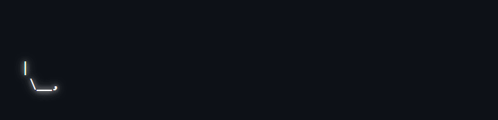
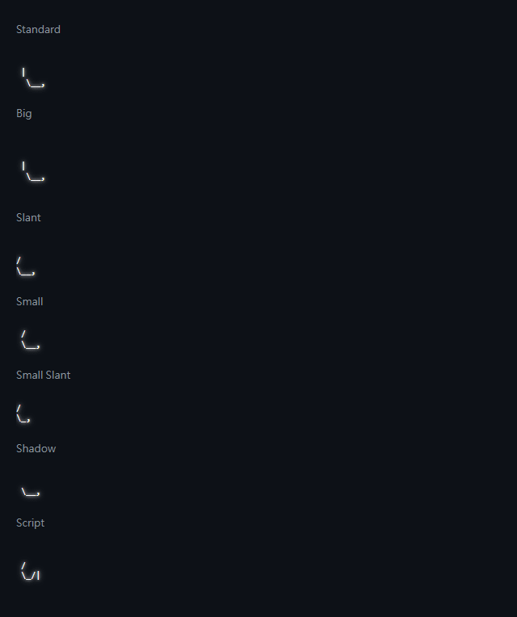
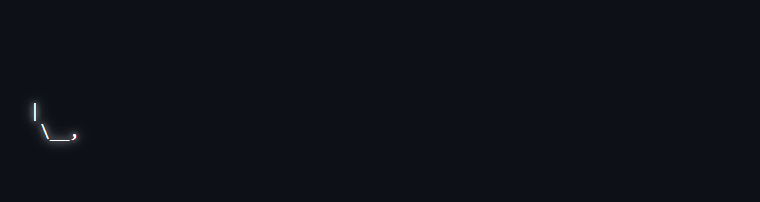

# ascii-scribe

A Web Component that **writes** [figlet](https://github.com/patorjk/figlet.js) ASCII art stroke by stroke, the way a
pen would. It pauses, erases in reverse, and moves on to the next sentence.



The stroke order is **derived from the figlet output itself**. There is no hand-made stroke data for any letter, so
any ASCII text works in every bundled font, including symbols like `& @ { } # ?`.

- One `<script>` tag, no build step, no framework. About 30 KB gzipped, with figlet.js and 7 fonts inside.
- The final frame is character-for-character identical to `figlet.textSync()`.
- Respects `prefers-reduced-motion` and screen readers. Shrinks to fit narrow screens, and Shadow DOM keeps page CSS out.

## Quick start

```html
<script type="module" src="https://cdn.jsdelivr.net/gh/yPin9/ascii-scribe@v1.0.0/dist/ascii-scribe.js"></script>

<ascii-scribe strings='["ascii-scribe", "S&@ 42?"]'></ascii-scribe>
```

The element takes its colour and maximum size from the page (`color`, `font-size`):

```css
ascii-scribe { color: #7ee787; font-size: 18px; }
```

## Attributes

| Attribute | Default | What it does |
|---|---|---|
| `strings` | — | Sentences to write, as a JSON array (`'["one", "two"]'`) or one plain sentence. Printable ASCII only. |
| `font` | `Standard` | `Standard`, `Big`, `Slant`, `Small`, `Small Slant`, `Shadow`, `Script`. Unknown names fall back to `Standard`. |
| `speed` | `70` | Base pace in cells per second. Erasing runs 3× faster. |
| `pause` | `1500` | How many ms a finished sentence stays on screen. |
| `lift` | `120` | How many ms the pen pauses when it lifts between strokes. |
| `ease` | on | Slow at the start and end of each stroke, fast in the middle. `ease="false"` writes at an even pace. |
| `tip` | on | Freshly written cells glow and fade like wet ink. `tip="false"` turns the glow off. |
| `loop` | on | Cycle through the sentences forever. `loop="false"` stops when the last sentence is written. |

Changing any attribute restarts the animation.

### Styling

| Hook | Use |
|---|---|
| `color`, `font-size` on the element | Ink colour, and the maximum size before shrink-to-fit. |
| `--ascii-scribe-tip` | Pen-tip glow colour (default `#fff`). On a light page use a darker colour, e.g. `#1a7f37`. |
| `ascii-scribe::part(art)` | The `<pre>` that holds the art. |

### Events

`ascii-scribe:written` and `ascii-scribe:erased` fire with `detail: { index, text }`. Both bubble and are composed.

```js
document.querySelector('ascii-scribe')
  .addEventListener('ascii-scribe:written', (e) => console.log('wrote', e.detail.text));
```

## Fonts

Seven line-style fonts from the official FIGlet distribution are bundled:





## Accessibility

- Screen readers get `role="img"` with `aria-label` set to the sentences. The ASCII art itself is `aria-hidden`.
- With `prefers-reduced-motion: reduce`, the first sentence is shown complete, without animation or glow.
- The art shrinks to fit the element's width, so long sentences don't cause horizontal scrolling on phones.

## How the stroke order is found

figlet draws letters with `| _ / \ - ( ) < >` and similar characters. ascii-scribe treats each of these as a short
line segment inside its cell, for example `/` from bottom-left to top-right and `_` along the bottom edge. A simulated
pen enters a segment at one end and leaves from the other. It continues a stroke only into a neighbouring cell whose
segment starts close to the pen tip. Otherwise it lifts and starts a new stroke at a free end. Letters are written
left to right. Letter boundaries come from measuring how wide figlet renders each prefix of the text.

The tests check this against randomly generated strings in all 7 fonts:

- the final frame is exact;
- consecutive cells within a stroke touch;
- strokes are long;
- writing follows the glyphs' directions measurably better than character-blind orders, such as row/column scans,
  diagonal sweeps and greedy walks.

In a real browser, every frame the component draws must also be a prefix of the engine's order.

## Development

```sh
npm install
npm test         # unit, property and headless-browser tests (needs a local Chrome/Edge/Chromium, or CHROME_PATH)
npm run build    # dist/ascii-scribe.js
npm run demo     # playground at http://localhost:8080/demo/
npm run gifs     # re-record docs/*.gif from the built component
```

## License

[MIT](LICENSE)
